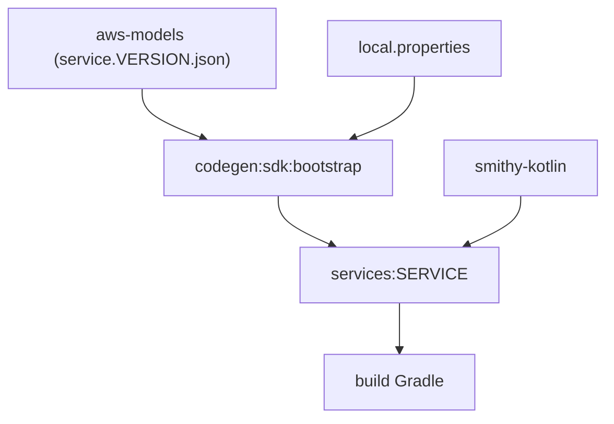

# aws/aws-sdk-kotlin

> SDK Kotlin officiel d'Amazon pour appeler les services AWS, avec sa feuille de route publique.

## Le problème
Appeler les services AWS depuis Kotlin demande des clients typés, asynchrones et à jour.

## Ce que ça fait vraiment
Les clients sont générés depuis les modèles de services par Gradle : le code généré n'est pas dans le dépôt. On génère les services voulus (`aws.services`, `aws.protocols`) puis on les construit. La doc d'API se produit avec Dokka.

## Comment c'est branché


## Essayer
```bash
./gradlew --no-daemon :codegen:sdk:bootstrap
./gradlew :services:lambda:build
./gradlew --no-daemon -Paws.services=+lambda :codegen:sdk:bootstrap
```

## Coût et pièges
Le SDK est gratuit, mais les appels AWS sont facturés à ton compte. Il faut Gradle et la JVM (Java et Kotlin ne figurent pas dans la liste de prérequis). Les tests locaux demandent de publier d'autres dépôts en Maven local.

## Ce que ce n'est pas
Pas un SDK Python : pour de la data, boto3 est le chemin habituel.

## Alternatives
Aucune alternative nommée dans le README.

## Pour toi
À ignorer, sauf projet Kotlin/JVM sur AWS : en data/MLOps, tu passeras plus probablement par le SDK Python.

