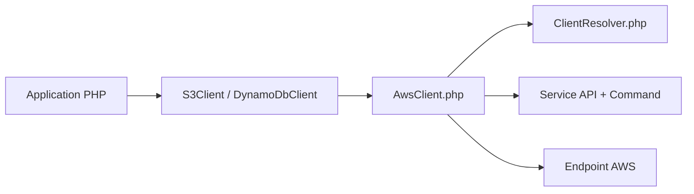

# aws/aws-sdk-php

> Official SDK for calling AWS services from PHP code, for PHP developers.

## The problem
Calling S3, DynamoDB or other AWS services over raw HTTP means handling signatures, regions and errors yourself.

## What it actually does
Provides generated clients for more than 400 services, built on Guzzle. `AwsClient` carries the common configuration, resolves parameters (`ClientResolver`) and executes operations. Adds paginators, waiters, S3 multipart upload, an S3 stream wrapper, an S3 encryption client and a DynamoDB session handler.

## How it is wired


## Trying it
```bash
composer require aws/aws-sdk-php
```

## Cost and gotchas
The SDK is free but AWS calls are billed. An AWS account and credentials are required. PHP ≥ 8.2; patched PHP versions recommended. Remove unused services via Composer to slim it down.

## What it is not
Not a tool for Python or data science. GitHub issues are not support: use StackOverflow or AWS Support.

## Alternatives
No alternative named in the README (other AWS SDKs: js, ruby, python, java).

## For you
Worth watching: without PHP, there is nothing to do with it; in that case boto3 would be your equivalent.
