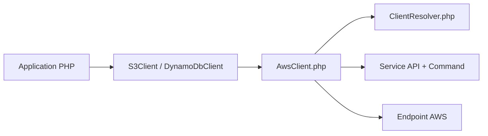

# aws/aws-sdk-php

> SDK officiel pour appeler les services AWS depuis du code PHP, pour les développeurs PHP.

## Le problème
Appeler S3, DynamoDB ou les autres services AWS en HTTP brut impose de gérer signatures, régions et erreurs.

## Ce que ça fait vraiment
Fournit des clients générés pour plus de 400 services, construits sur Guzzle. `AwsClient` porte la configuration commune, résout les paramètres (`ClientResolver`) et exécute les opérations. Ajoute paginateurs, waiters, upload multipart S3, wrapper de flux S3, client de chiffrement S3 et gestionnaire de sessions DynamoDB.

## Comment c'est branché


## Essayer
```bash
composer require aws/aws-sdk-php
```

## Coût et pièges
Le SDK est gratuit mais les appels AWS sont facturés. Il faut un compte AWS et des identifiants. PHP ≥ 8.2 ; versions de PHP patchées recommandées. Retirer les services inutilisés via Composer pour alléger.

## Ce que ce n'est pas
Pas un outil pour Python ou data science. Les issues GitHub ne sont pas un support : StackOverflow ou AWS Support.

## Alternatives
Aucune alternative nommée dans le README (autres SDK AWS : js, ruby, python, java).

## Pour toi
À surveiller : sans PHP, rien à en faire ; dans ce cas boto3 serait ton équivalent.

