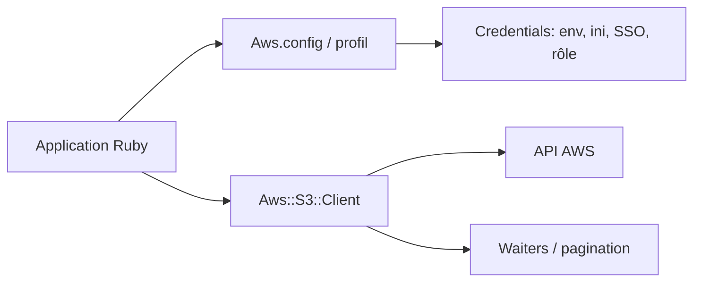

# aws/aws-sdk-ruby

> The official AWS SDK for Ruby, one gem per service, for Ruby developers who call AWS.

## The problem
Calling AWS APIs by hand (signing, regions, pagination, waiting for states) is slow and error-prone.

## What it actually does
One client per service (`Aws::S3::Client`, `Aws::EC2::Client`…) with one method per API operation. Responses are enumerable (pagination), and "waiters" poll a state until it is reached. Credentials are looked up in the environment, `~/.aws/credentials`, `~/.aws/config`, SSO, roles or instance profile. A REPL console (`aws-v3.rb`) ships with the `aws-sdk` gem.

## How it is wired


## Trying it
```bash
# Gemfile
gem 'aws-sdk-s3', '~> 1'
# ou tout le SDK
gem 'aws-sdk', '~> 3'
# REPL interactif
aws-v3.rb
```

## Cost and gotchas
An AWS account and credentials are required; calls are billed by AWS. Shared credentials are loaded once and do not refresh. The full `aws-sdk` gem is very large: prefer the per-service gems.

## What it is not
Not an ML tool or an orchestrator. The "Resource" interfaces cover only a few services and have limits: the README asks you to use the Client API. The CRT part is in developer preview.

## Alternatives
No alternative named in the README.

## For you
Worth watching: useful only if your MLOps pipelines or scripts are in Ruby, otherwise boto3 (Python) will be your reflex; the README does not mention it.
