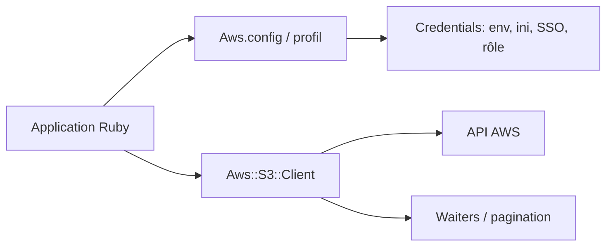

# aws/aws-sdk-ruby

> Le SDK officiel AWS pour Ruby, un gem par service, pour les développeurs Ruby qui appellent AWS.

## Le problème
Appeler les API AWS à la main (signature, régions, pagination, attente d'états) est long et source d'erreurs.

## Ce que ça fait vraiment
Un client par service (`Aws::S3::Client`, `Aws::EC2::Client`…) avec une méthode par opération d'API. Les réponses sont énumérables (pagination), des « waiters » interrogent un état jusqu'à son obtention. Les identifiants sont cherchés dans l'environnement, `~/.aws/credentials`, `~/.aws/config`, SSO, rôles ou profil d'instance. Une console REPL (`aws-v3.rb`) est livrée avec le gem `aws-sdk`.

## Comment c'est branché


## Essayer
```bash
# Gemfile
gem 'aws-sdk-s3', '~> 1'
# ou tout le SDK
gem 'aws-sdk', '~> 3'
# REPL interactif
aws-v3.rb
```

## Coût et pièges
Compte AWS et identifiants requis ; les appels sont facturés par AWS. Les identifiants partagés sont chargés une seule fois et ne se rafraîchissent pas. Le gem `aws-sdk` complet est très volumineux : préférer les gems par service.

## Ce que ce n'est pas
Pas un outil ML ni un orchestrateur. Les interfaces « Resource » ne couvrent que peu de services et ont des limites : le README demande d'utiliser l'API Client. La partie CRT est en developer preview.

## Alternatives
Aucune alternative nommée dans le README.

## Pour toi
À surveiller : utile seulement si tes pipelines MLOps ou scripts sont en Ruby, sinon boto3 (Python) sera ton réflexe ; le README ne le cite pas.

