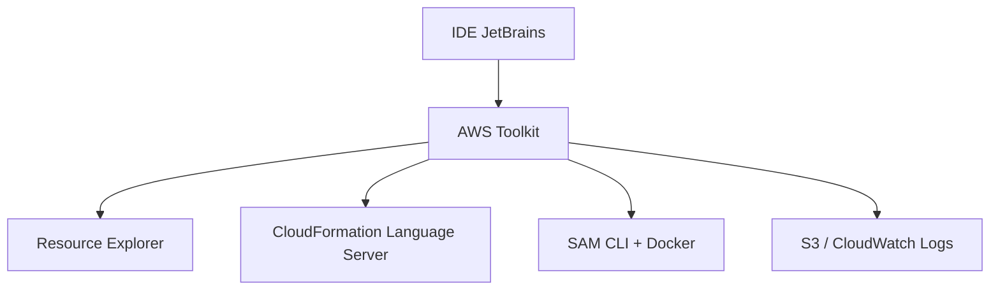

# aws/aws-toolkit-jetbrains

> Official JetBrains IDE plugin for developing on AWS (Lambda, S3, CloudFormation, CloudWatch).

## The problem
Browsing AWS resources and debugging Lambdas forces you to leave the IDE for the console or the command line.

## What it actually does
Adds a resource explorer, authentication (keys, SSO, Builder ID), CloudFormation template editing with validation and drift detection, local Lambda execution and debugging via SAM CLI, CloudWatch log reading, S3 bucket management and connection to RDS or Redshift.

## How it is wired
Simplified diagram based on the sheet, no diagram provided.


## Trying it
```bash
# Installation depuis le dépôt de plugins JetBrains.
# Canal EAP : ajouter l'URL https://plugins.jetbrains.com/plugins/eap/aws.toolkit
```

## Cost and gotchas
The plugin is free but requires an AWS account, a user and an access key; resource usage is billed by AWS. SAM CLI and Docker for local Lambda. Database features require a paid JetBrains product.

## What it is not
Not a multicloud abstraction layer nor an AI tool. Only a subset of AWS resources is visible.

## Alternatives
No alternative named in the README.

## For you
Worth watching if you work in PyCharm or IntelliJ with AWS (Lambda, S3): comfortable, with no value elsewhere.
