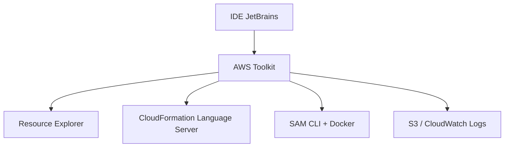

# aws/aws-toolkit-jetbrains

> Plugin officiel des IDE JetBrains pour développer sur AWS (Lambda, S3, CloudFormation, CloudWatch).

## Le problème
Parcourir les ressources AWS et déboguer des Lambda oblige à quitter l'IDE pour la console ou la ligne de commande.

## Ce que ça fait vraiment
Ajoute un explorateur de ressources, l'authentification (clés, SSO, Builder ID), l'édition de modèles CloudFormation avec validation et détection de dérive, l'exécution et le débogage locaux de Lambda via SAM CLI, la lecture de journaux CloudWatch, la gestion de buckets S3 et la connexion à RDS ou Redshift.

## Comment c'est branché
Schéma simplifié d'après la fiche, sans diagramme fourni.


## Essayer
```bash
# Installation depuis le dépôt de plugins JetBrains.
# Canal EAP : ajouter l'URL https://plugins.jetbrains.com/plugins/eap/aws.toolkit
```

## Coût et pièges
Le plugin est gratuit mais requiert un compte AWS, un utilisateur et une clé d'accès ; l'usage des ressources est facturé par AWS. SAM CLI et Docker pour Lambda en local. Les fonctions de base de données exigent un produit JetBrains payant.

## Ce que ce n'est pas
Pas une couche d'abstraction multicloud ni un outil d'IA. Seul un sous-ensemble des ressources AWS est visible.

## Alternatives
Aucune alternative nommée dans le README.

## Pour toi
À surveiller si tu travailles sous PyCharm ou IntelliJ avec AWS (Lambda, S3) : confortable, sans valeur ailleurs.

