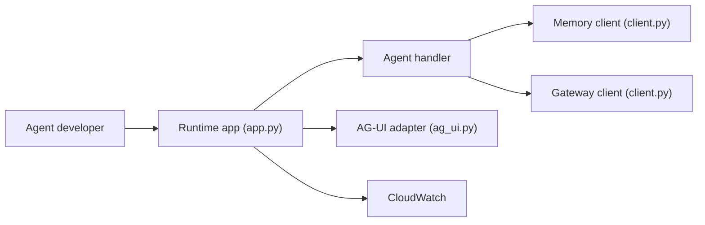

# aws/bedrock-agentcore-sdk-python

> Python SDK to deploy a local agent on Amazon Bedrock AgentCore and compose its services.

## The problem
Moving an agent from a dev machine to secure hosting requires handling runtime, memory, authentication and tracing.

## What it actually does
Provides `BedrockAgentCoreApp`: you register a handler with `@app.entrypoint`, and the runtime receives invocations and streams the response. Modules cover memory (sessions), gateway (API to MCP tools), knowledge base, browser, code interpreter, identity, policy, payments, evaluation and OpenTelemetry tracing. AG-UI and A2A protocol adapters. Works with Strands, LangGraph, CrewAI, Autogen or in-house code.

## How it is wired


## Trying it
```bash
pip install "bedrock-agentcore[ag-ui]"
npm i -g @aws/agentcore
agentcore create --name MyAgent --defaults
cd MyAgent
agentcore deploy
```

## Cost and gotchas
AgentCore services are billed by AWS; an AWS account and credentials are required. The CLI generates CDK and provisions the infrastructure. 121 open issues.

## What it is not
Not an agent framework: it brings neither the logic nor the models, only hosting and AWS services. The README touts reliability and security without numerical proof.

## Alternatives
No alternative named in the README.

## For you
Worth watching: relevant if you already deploy on AWS and want a managed agent runtime; the lock-in to AgentCore is the price to weigh.
