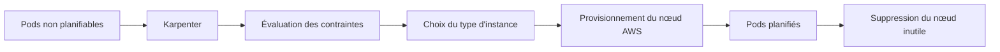

# aws/karpenter-provider-aws

> Kubernetes node provisioner that creates and deletes machines according to pending pods.

## The problem
Autoscaling groups size fixed pools: you pay for nodes that are too big, or pods stay pending for lack of the right instance type.

## What it actually does
Four steps, described as such in the README: watch for pods that the Kubernetes scheduler has marked unschedulable; evaluate their scheduling constraints — resource requests, nodeSelectors, affinities, tolerations, topology spread constraints; provision nodes that satisfy these requirements; remove them when they are no longer needed.

## How it is wired


## Trying it
```bash
# Aucune commande documentée dans le README : il renvoie aux « Docs » du projet
# et au canal #karpenter du Slack Kubernetes.
```

## Cost and gotchas
The project is free, but the nodes it starts are billed by AWS — that is the whole point of the tool. The README documents neither installation, nor configuration, nor the required IAM permissions: everything is in the external documentation.

## What it is not
It is not a pod autoscaler: it acts on nodes, not on replicas. It is not multi-cloud — this repository is the AWS provider. The README is almost entirely a list of conference talks, with no usable technical content.

## Alternatives
- **Kubernetes Cluster Autoscaler**: cited in a conference title as a point of comparison.

## For you
Irrelevant for a data profile; it is a matter of Kubernetes platform on AWS.
