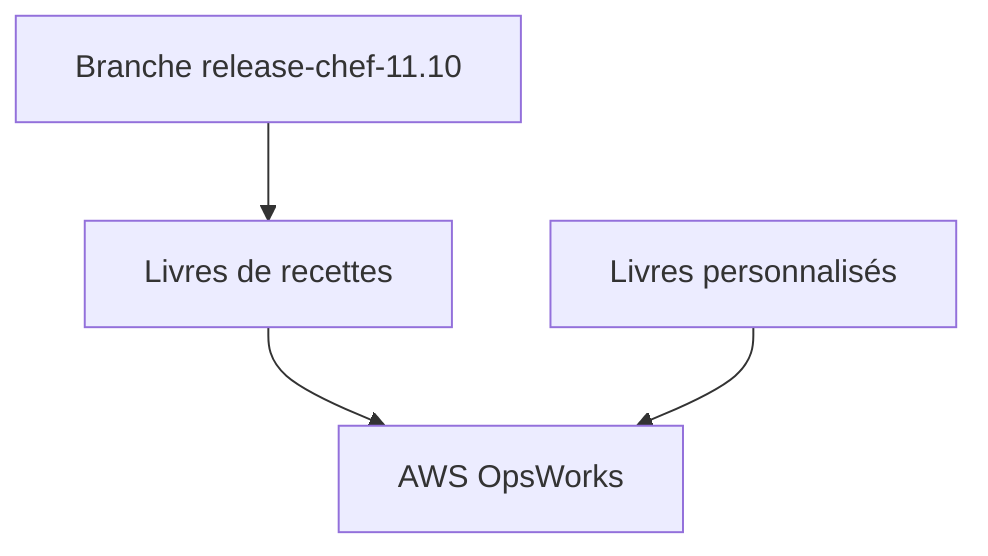

# aws/opsworks-cookbooks

> Chef recipes used by AWS OpsWorks for versions 11.10, 11.4 and 0.9, for OpsWorks users.

## The problem
To override an OpsWorks template (Rails database.yml, Apache vhost), you have to find the original.

## What it actually does
- Contains the cookbooks built into the official OpsWorks releases for Chef 11.10, 11.4 (deprecated) and 0.9 (deprecated).
- Serves as a reference for overriding the provided templates.
- The version branches carry the official cookbooks; `master` is not used.
- No built-in cookbooks for Chef 12 (Windows 12.2 and Linux).

## How it is wired
Simplified diagram based on the sheet, no diagram provided.


## Trying it
```bash
# Aucune commande documentée dans le README.
```

## Cost and gotchas
An AWS account and Chef are needed to use it; do not reuse the names of built-in cookbooks for custom cookbooks, or it will fail.

## What it is not
Not a standalone installable product: an archived recipe repository for an old service. Apache 2.0 license announced, but some imported files fall under other licenses.

## Alternatives
No alternative named in the README.

## For you
Ignore: Chef 11 and OpsWorks are outdated; nothing for current data, AI or MLOps work.
