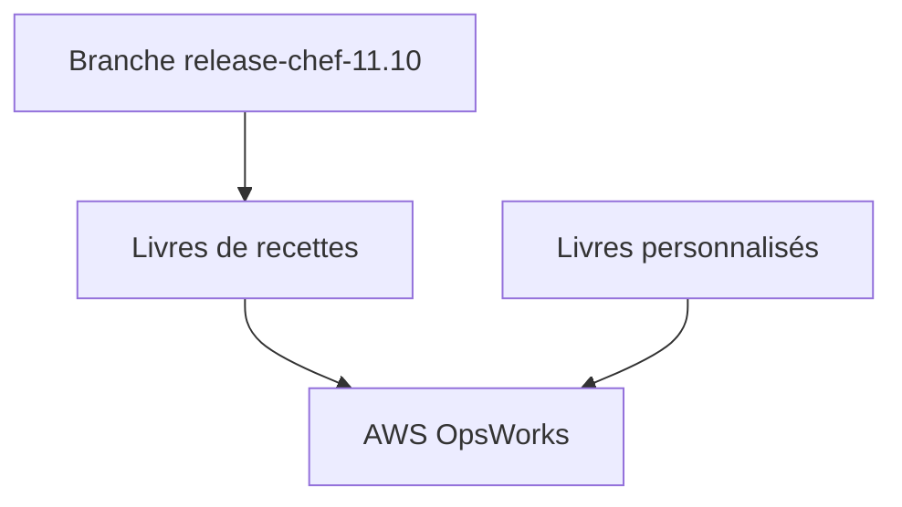

# aws/opsworks-cookbooks

> Recettes Chef utilisées par AWS OpsWorks pour les versions 11.10, 11.4 et 0.9, pour utilisateurs OpsWorks.

## Le problème
Pour surcharger un gabarit OpsWorks (database.yml de Rails, vhost Apache), il faut retrouver l'original.

## Ce que ça fait vraiment
- Contient les livres de recettes intégrés aux versions officielles d'OpsWorks pour Chef 11.10, 11.4 (dépréciée) et 0.9 (dépréciée).
- Sert de référence pour surcharger les gabarits fournis.
- Les branches de version portent les livres officiels, `master` n'est pas utilisée.
- Aucun livre intégré pour Chef 12 (Windows 12.2 et Linux).

## Comment c'est branché
Schéma simplifié d'après la fiche, sans diagramme fourni.


## Essayer
```bash
# Aucune commande documentée dans le README.
```

## Coût et pièges
Compte AWS et Chef nécessaires pour s'en servir ; ne pas réutiliser les noms de livres intégrés pour des livres personnalisés, sous peine d'échec.

## Ce que ce n'est pas
Pas un produit installable autonome : un dépôt de recettes archivé pour un service ancien. Licence Apache 2.0 annoncée, mais certains fichiers importés relèvent d'autres licences.

## Alternatives
Aucune alternative nommée dans le README.

## Pour toi
À ignorer : Chef 11 et OpsWorks sont dépassés ; rien pour du travail data, IA ou MLOps actuel.

