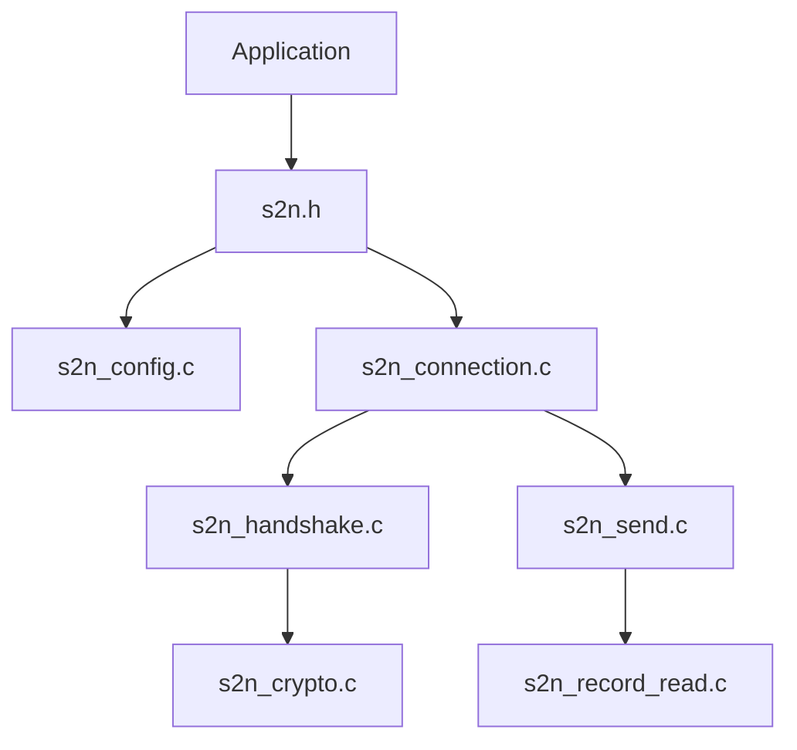

# aws/s2n-tls

> AWS's C99 TLS/SSL implementation, small and security-oriented, with C and Rust interfaces.

## The problem
Encrypting network communications with a TLS library that is simple to audit, without the large historical suites.

## What it actually does
s2n-tls negotiates the TLS handshake (SSLv3 to TLS 1.3, SNI, ALPN, OCSP), encrypts and authenticates records, and handles session resumption. It relies on a libcrypto of your choice (AWS-LC, OpenSSL, LibreSSL, BoringSSL). It masks response timings, wipes data once read, and has no DTLS. It supports QUIC and kTLS, and has Rust bindings with a Tokio adapter.

## How it is wired


## Trying it
```bash
git clone https://github.com/aws/s2n-tls.git
cd s2n-tls
sudo apt install cmake libssl-dev
cmake . -Bbuild -DCMAKE_BUILD_TYPE=Release -DCMAKE_INSTALL_PREFIX=./s2n-tls-install
cmake --build build -j $(nproc)
ctest --test-dir build
```

## Cost and gotchas
Free. It needs cmake and a libcrypto; on Windows, MSYS2/MinGW and AWS-LC only. SSLv3, RC4, 3DES and DHE are disabled by default.

## What it is not
Not a ready-to-use client or server, but a library to integrate. No DTLS.

## Alternatives
The README mentions OpenSSL, LibreSSL, BoringSSL and AWS-LC as underlying crypto libraries, not as direct alternatives.

## For you
Keep an eye on it: worth knowing if you work on networking in C or Rust, but rarely something to handle directly in data or AI.
