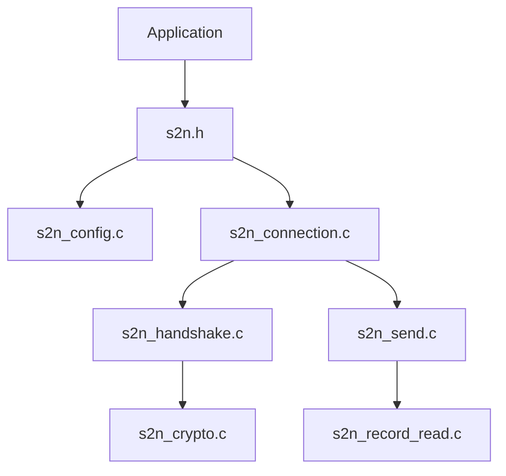

# aws/s2n-tls

> Implémentation TLS/SSL en C99 d'AWS, petite et orientée sécurité, avec interfaces C et Rust.

## Le problème
Chiffrer des communications réseau avec une bibliothèque TLS simple à auditer, sans les gros ensembles historiques.

## Ce que ça fait vraiment
s2n-tls négocie la poignée de main TLS (SSLv3 à TLS 1.3, SNI, ALPN, OCSP), chiffre et authentifie les enregistrements et gère la reprise de session. Elle s'appuie sur une libcrypto au choix (AWS-LC, OpenSSL, LibreSSL, BoringSSL). Elle masque les temps de réponse, efface les données lues et n'a pas de DTLS. Support de QUIC et de kTLS, et liaisons Rust avec adaptateur Tokio.

## Comment c'est branché


## Essayer
```bash
git clone https://github.com/aws/s2n-tls.git
cd s2n-tls
sudo apt install cmake libssl-dev
cmake . -Bbuild -DCMAKE_BUILD_TYPE=Release -DCMAKE_INSTALL_PREFIX=./s2n-tls-install
cmake --build build -j $(nproc)
ctest --test-dir build
```

## Coût et pièges
Gratuit. Il faut cmake et une libcrypto ; sous Windows, MSYS2/MinGW et AWS-LC uniquement. SSLv3, RC4, 3DES et DHE sont désactivés par défaut.

## Ce que ce n'est pas
Pas un client ou serveur prêt à l'emploi, mais une bibliothèque à intégrer. Pas de DTLS.

## Alternatives
Le README cite OpenSSL, LibreSSL, BoringSSL et AWS-LC comme bibliothèques de chiffrement sous-jacentes, pas comme alternatives directes.

## Pour toi
Surveiller : utile à connaître si tu touches à du réseau en C ou Rust, mais rarement à manipuler directement en data ou IA.

