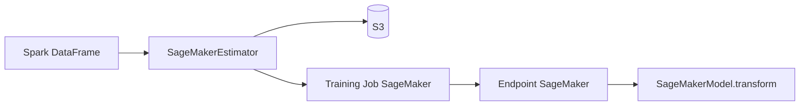

# aws/sagemaker-spark

> Spark library to train and serve models on Amazon SageMaker from DataFrames.

## The problem
Plugging a Spark ML pipeline into SageMaker training and hosting means serializing data, launching jobs and calling endpoints by hand.

## What it actually does
Provides Spark ML pipeline stages (estimators and models) that run on SageMaker. `fit()` sends the DataFrame to S3, launches a training job, creates the model and endpoint; `transform()` queries the endpoint and adds the prediction columns. Algorithms provided: K-Means, PCA, XGBoost, or your own Docker container.

## How it is wired
Simplified diagram based on the sheet, no diagram provided.


## Trying it
```bash
spark-shell --packages com.amazonaws:sagemaker-spark_2.11:spark_2.2.0-1.0
```

## Cost and gotchas
AWS account, IAM role, training instances and endpoints are billed. The README targets Spark 2.1 and 2.2 with Hadoop 2.8: very old. Java/Scala installation goes through Maven; the Python version has its own documentation.

## What it is not
Not a modern library: the documented versions date from Spark 2.x. Endpoints created keep being billed as long as they exist.

## Alternatives
No alternative named in the README.

## For you
Watch: only if you already have Spark and SageMaker in production; the versions described are old.
