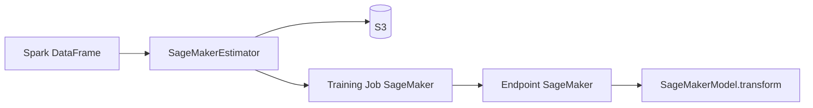

# aws/sagemaker-spark

> Bibliothèque Spark pour entraîner et servir des modèles sur Amazon SageMaker depuis des DataFrames.

## Le problème
Brancher un pipeline Spark ML sur l'entraînement et l'hébergement SageMaker demande de sérialiser les données, lancer les jobs et appeler les endpoints à la main.

## Ce que ça fait vraiment
Fournit des étapes de pipeline Spark ML (estimateurs et modèles) qui s'exécutent sur SageMaker. `fit()` envoie le DataFrame en S3, lance un job d'entraînement, crée modèle et endpoint ; `transform()` interroge l'endpoint et ajoute les colonnes de prédiction. Algorithmes fournis : K-Means, PCA, XGBoost, ou votre propre conteneur Docker.

## Comment c'est branché
Schéma simplifié d'après la fiche, sans diagramme fourni.


## Essayer
```bash
spark-shell --packages com.amazonaws:sagemaker-spark_2.11:spark_2.2.0-1.0
```

## Coût et pièges
Compte AWS, rôle IAM, instances d'entraînement et endpoints facturés. Le README cible Spark 2.1 et 2.2 avec Hadoop 2.8 : très ancien. L'installation Java/Scala passe par Maven ; la version Python a sa propre documentation.

## Ce que ce n'est pas
Ce n'est pas une bibliothèque moderne : les versions documentées datent de Spark 2.x. Les endpoints créés continuent à être facturés tant qu'ils existent.

## Alternatives
Aucune alternative nommée dans le README.

## Pour toi
À surveiller : seulement si tu as déjà Spark et SageMaker en production ; les versions décrites sont anciennes.

