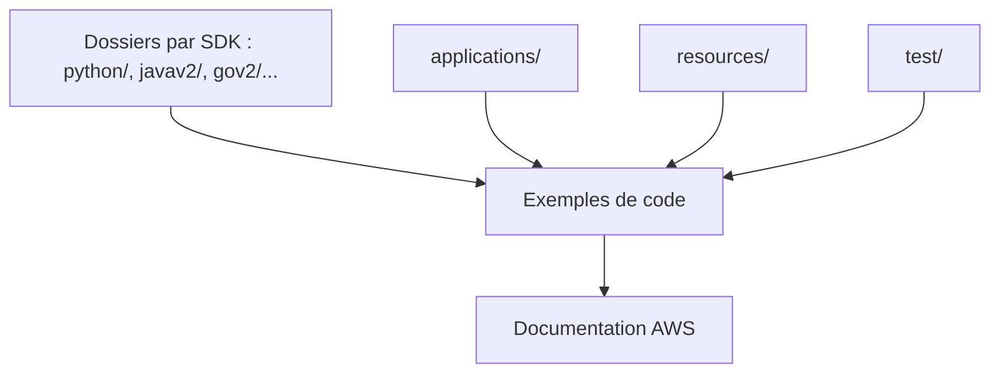

# awsdocs/aws-doc-sdk-examples

> Official code examples for calling AWS services from sixteen different language SDKs.

## The problem
Finding a reliable example for calling an AWS service in your own language, instead of pasting together blog snippets.

## What it actually does
One folder per SDK (Python, Java, JavaScript, Go, Rust, .NET, etc.), with instructions specific to each language. Some of the examples are injected into the AWS documentation. Multi-service applications and an automated testing framework complete the repository.

## How it is wired
Simplified diagram based on the sheet, no diagram provided.

## Trying it
No command documented at the root: each SDK folder has its own instructions. You need an AWS account and configured credentials (AWS CLI).

## Cost and gotchas
AWS account and credentials required; the examples can create or delete resources and incur charges.
The README advises backing up your data before running an example.

## What it is not
Not a library to install: these are examples to read and adapt.
The test framework (/test) is flagged as under construction.

## Alternatives
- aws-samples/serverless-snippets: snippets dedicated to serverless, cited as another source of the documentation.
- aws/aws-tools-for-powershell: for PowerShell examples.

## For you
Keep an eye on it: useful as a boto3 reference (python/ folder) when you build a pipeline on AWS, useless outside that ecosystem.
