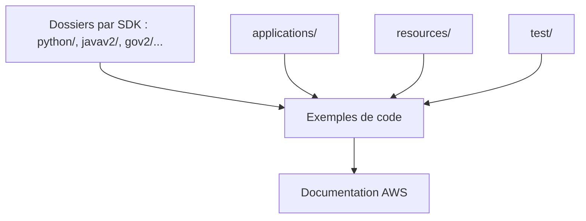

# awsdocs/aws-doc-sdk-examples

> Exemples de code officiels pour appeler les services AWS depuis seize SDK de langages différents.

## Le problème
Trouver un exemple fiable pour appeler un service AWS dans son langage, au lieu de recoller des extraits de blog.

## Ce que ça fait vraiment
Un dossier par SDK (Python, Java, JavaScript, Go, Rust, .NET, etc.), avec des instructions propres à chaque langage. Une partie des exemples est injectée dans la documentation AWS. Des applications multi-services et un cadre de tests automatisés complètent le dépôt.

## Comment c'est branché
Schéma simplifié d'après la fiche, sans diagramme fourni.

## Essayer
Aucune commande documentée à la racine : chaque dossier de SDK a son propre mode d'emploi. Il faut un compte AWS et des identifiants configurés (AWS CLI).

## Coût et pièges
Compte AWS et identifiants obligatoires ; les exemples peuvent créer ou supprimer des ressources et générer des frais.
Le README conseille de sauvegarder ses données avant de lancer un exemple.

## Ce que ce n'est pas
Pas une bibliothèque à installer : ce sont des exemples à lire et adapter.
Le cadre de test (/test) est signalé comme en construction.

## Alternatives
- aws-samples/serverless-snippets : extraits dédiés au serverless, cités comme autre source de la documentation.
- aws/aws-tools-for-powershell : pour les exemples PowerShell.

## Pour toi
À surveiller : utile comme référence boto3 (dossier python/) quand tu montes un pipeline sur AWS, inutile hors de cet écosystème.

