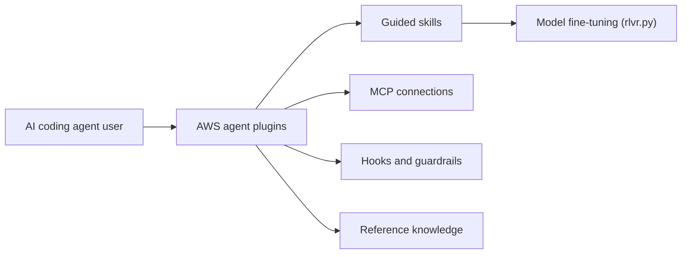

# awslabs/agent-plugins

> AWS plugins (skills, MCP servers, hooks) for Claude Code, Codex and Cursor.

## The problem
Coding agents know AWS best practices poorly, and pasting long guides into prompts bloats the context.

## What it actually does
Repository of packaged plugins: skills (guided workflows), MCP servers (documentation, pricing, IaC, Aurora DSQL), hooks (`sam validate` validation, schema checking) and references. Plugins listed: Amazon Location Service, Amplify, serverless, transform, code documentation, databases, deployment, GCP to AWS migration, SageMaker AI. The README announces that the Agent Toolkit for AWS is its successor.

## How it is wired


## Trying it
```bash
/plugin marketplace add awslabs/agent-plugins
/plugin install sagemaker-ai@agent-plugins-for-aws
/plugin install deploy-on-aws@agent-plugins-for-aws
```

## Cost and gotchas
Plugins are free, but the AWS resources deployed are at your expense. You need a configured AWS CLI and Claude Code ≥ 2.1.29 or Cursor ≥ 2.5. The README asks you to review the generated code and the costs.

## What it is not
It is not an infrastructure tool: it guides an agent. The README announces that the most useful projects will migrate to the Agent Toolkit for AWS; this repository "continues to work".

## Alternatives
Agent Toolkit for AWS: successor announced in the README (IAM condition keys, CloudWatch/CloudTrail visibility).

## For you
Worth watching: the `sagemaker-ai` plugin is of interest to an MLOps profile on AWS, but since the repository is set to migrate to the Agent Toolkit, look at that one before investing in this.
