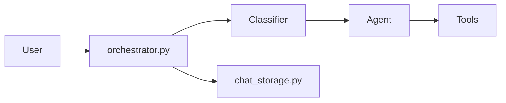

# awslabs/agent-squad

> Framework that routes each request to the right specialized agent, in Python, TypeScript and Swift.

## The problem
With several specialized agents, you have to decide which one answers while keeping the conversation's context.

## What it actually does
A classifier chooses the agent based on descriptions and history; the agent answers (with tools); the orchestrator records the exchange. Ready-to-use agents (Bedrock, Anthropic, OpenAI, Lex, Lambda), streamed responses, SupervisorAgent (a team of agents in parallel) and GroundedAgent (two LLMs to limit hallucinations). The Swift runtime works entirely on the device (MCP, real-time voice, tracing).

## How it is wired


## Trying it
```bash
npm install agent-squad
pip install "agent-squad[aws]"
```

## Cost and gotchas
API keys from the model provider (Bedrock, OpenAI, Anthropic...). The project has moved: the README announces `2fastlabs/agent-squad` as the new repository, and it used to be called `multi-agent-orchestrator`.

## What it is not
It is not a model or a single agent: it is a routing layer. This repository is no longer the official address according to its README.

## Alternatives
Not documented: the README names no alternative.

## For you
Worth watching: useful for routing several agents, but the repository has migrated; follow the new repository before committing to it.
