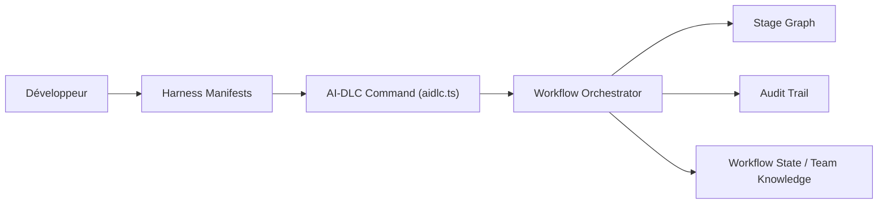

# awslabs/aidlc-workflows

> Framework of structured workflows with human approvals for coding assistants, shared across seven environments.

## The problem
Ad hoc development with an AI assistant loses context as the project grows, with no trace of decisions or approvals.

## What it actually does
An `aidlc` command installs a neutral core and adapters for Claude Code, Kiro, Codex CLI, Cursor, opencode and Copilot. From `/aidlc`, an orchestrator picks a workflow profile, moves through a graph of stages (5 phases, 33 stages), stops at approval points and records an audit log (102 events), the state and learned rules. The internal wiring is partly inferred.

## How it is wired


## Trying it
```bash
curl -fsSL https://github.com/awslabs/aidlc-workflows/releases/latest/download/install.sh | sh
cd /path/to/your-project
aidlc config --harness claude
aidlc doctor
# puis, dans l'assistant : /aidlc Build a REST API for inventory management
```

## Cost and gotchas
Free; the model provider depends on the harness (Bedrock by default for Claude Code and Codex). The install script is run via `curl | sh`. 222 open issues.

## What it is not
Not a model nor an assistant: a methodology and an engine layered on your assistant. The README reminds that generative AI can be wrong.

## Alternatives
No alternative named in the README.

## For you
Keep an eye on it: interesting if your team wants traceability and approval points around coding assistants, but the gain depends on disciplined adoption.
