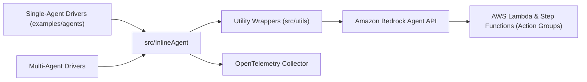

# awslabs/amazon-bedrock-agent-samples

> Examples of agents and multi-agent collaboration on Amazon Bedrock, for AWS developers.

## The problem
Using Bedrock Agents (action groups, guardrails, memory, multi-agent supervision) without starter examples is time-consuming.

## What it actually does
A collection of examples (`examples/agents`, `examples/multi_agent_collaboration`, Streamlit UX demos) with shared modules (`src/shared`: web search, working memory, stock data) and boto3 utilities (`src/utils`). Judging from the code, an InlineAgent library orchestrates calls to the Bedrock Agent API, with OpenTelemetry instrumentation.

## How it is wired

## Trying it
No commands in the README: it asks you to open the README of each example under `examples/*/*/`.

## Cost and gotchas
AWS account and access to Bedrock models; pay-as-you-go billing. Some examples use Lambda, DynamoDB, ECS or Amplify. Last push in April 2026.

## What it is not
Explicitly experimental and educational: not intended for production; Guardrails against prompt injection must be set up.

## Alternatives
- Amazon Bedrock Samples (cited repository): broader examples on the Bedrock side.

## For you
Ignore unless your company is committed to Bedrock: AWS-tied examples with no general relevance for data or MLOps.
