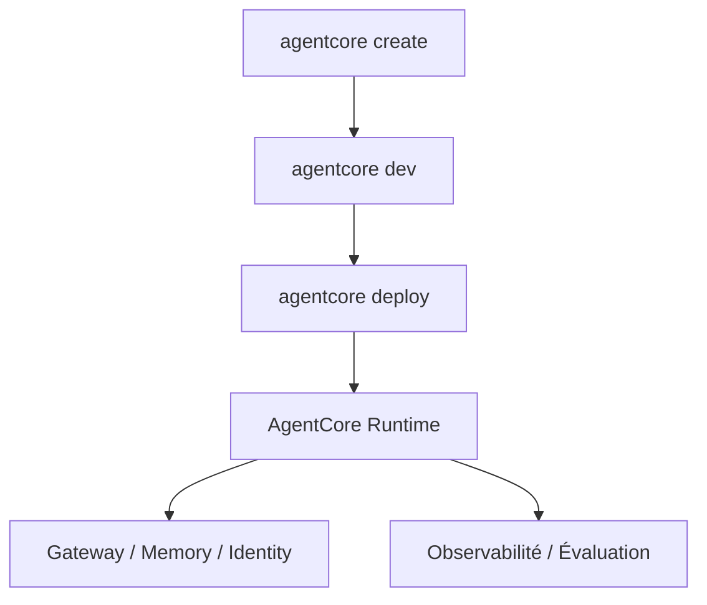

# awslabs/amazon-bedrock-agentcore-samples

> Examples and tutorials for deploying AI agents on Amazon Bedrock AgentCore, for AWS teams.

## The problem
Deploying AI agents to production requires infrastructure: execution, memory, identity, observability, evaluation.

## What it actually does
Gathers examples sorted by folder: `getting-started`, `features` (Runtime, Gateway, Identity, Memory, tools, observability, evaluation, Policy), `end-to-end`, `integrations`, `infrastructure-as-code` and `blueprints`. A CLI assistant creates a project with Strands Agents, LangGraph, Google ADK or OpenAI, in Python or TypeScript. Some examples are Jupyter notebooks. Examples that depend on the old Starter Toolkit are in `legacy/`.

## How it is wired
Simplified diagram based on the sheet, no diagram provided.


## Trying it
```bash
npm install -g @aws/agentcore
agentcore create
agentcore dev
agentcore deploy
agentcore invoke
```

## Cost and gotchas
An AWS account, broad permissions (`BedrockAgentCoreFullAccess`, `AmazonBedrockFullAccess`) and access to the Claude model in Bedrock are required. Deployment and usage are billed by AWS.

## What it is not
Not a reusable library: these are examples. They are tied to AWS, despite the "any framework, any model" billing. The repository is migrating to the new CLI.

## Alternatives
No alternative named in the README.

## For you
Worth watching: useful as a reference if you deploy agents on AWS, otherwise hard to transfer elsewhere.
