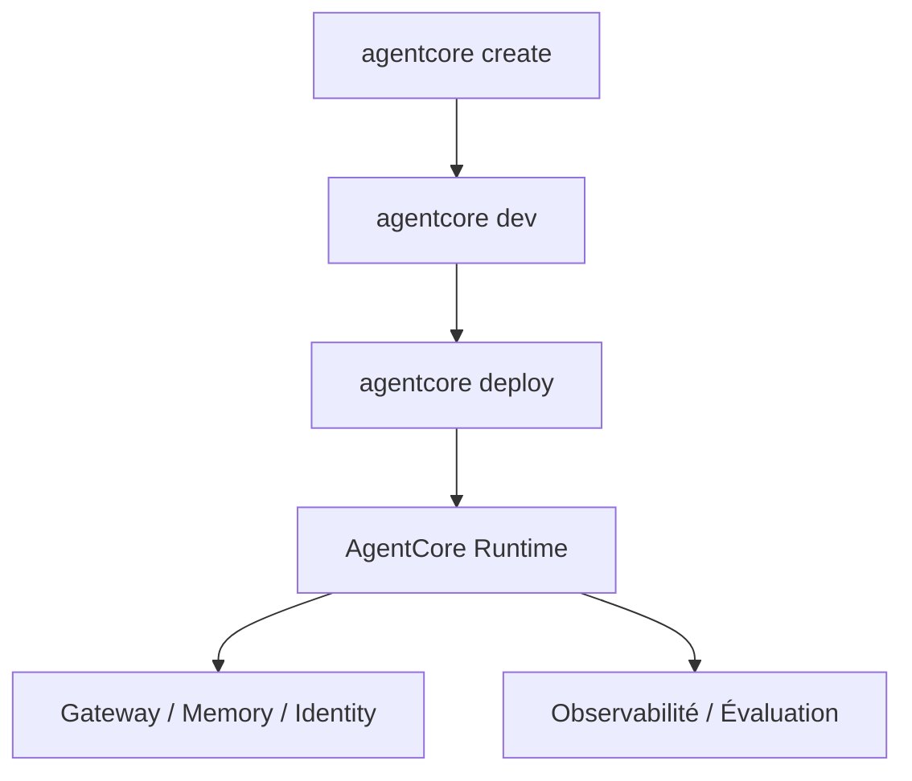

# awslabs/amazon-bedrock-agentcore-samples

> Exemples et tutoriels pour déployer des agents IA sur Amazon Bedrock AgentCore, pour équipes AWS.

## Le problème
Déployer des agents IA en production demande de l'infrastructure : exécution, mémoire, identité, observabilité, évaluation.

## Ce que ça fait vraiment
Rassemble des exemples classés par dossier : `getting-started`, `features` (Runtime, Gateway, Identity, Memory, outils, observabilité, évaluation, Policy), `end-to-end`, `integrations`, `infrastructure-as-code` et `blueprints`. Un assistant CLI crée un projet avec Strands Agents, LangGraph, Google ADK ou OpenAI, en Python ou TypeScript. Certains exemples sont des notebooks Jupyter. Les exemples dépendant de l'ancien Starter Toolkit sont dans `legacy/`.

## Comment c'est branché
Schéma simplifié d'après la fiche, sans diagramme fourni.


## Essayer
```bash
npm install -g @aws/agentcore
agentcore create
agentcore dev
agentcore deploy
agentcore invoke
```

## Coût et pièges
Un compte AWS, des permissions larges (`BedrockAgentCoreFullAccess`, `AmazonBedrockFullAccess`) et l'accès au modèle Claude dans Bedrock sont requis. Le déploiement et l'usage sont facturés par AWS.

## Ce que ce n'est pas
Pas une bibliothèque réutilisable : ce sont des exemples. Ils sont liés à AWS, malgré l'affichage « tout framework, tout modèle ». Le dépôt est en migration vers la nouvelle CLI.

## Alternatives
Aucune alternative nommée dans le README.

## Pour toi
À surveiller : utile comme référence si tu déploies des agents sur AWS, sinon peu transposable ailleurs.

