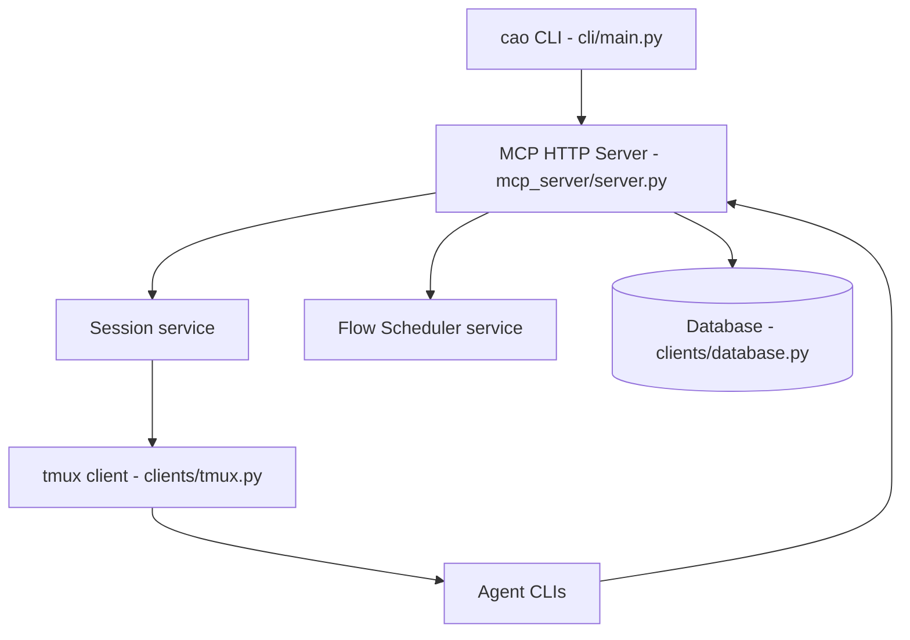

# awslabs/cli-agent-orchestrator

> Orchestrator that coordinates several coding-agent CLIs, a supervisor delegating to specialists through tmux.

## The problem
Several coding agents in CLI do not talk to each other: coordinating tasks in parallel or in sequence is done by hand.

## What it actually does
Runs a local `cao-server` (port 9889) that starts each provider CLI (Kiro CLI, Claude Code, Codex, Hermes, Kimi, Qwen, Copilot, OpenCode, Cursor, Grok Build…) in an isolated tmux session. Agents communicate through MCP tools: handoff (synchronous), assign (asynchronous), and message sending via an inbox. Adds Markdown agent profiles, scheduled flows, a web interface and tool restrictions.

## How it is wired


## Trying it
```bash
uv tool install git+https://github.com/awslabs/cli-agent-orchestrator.git@main --upgrade
cao install code_supervisor
cao-server
cd /path/to/your/project && cao launch --agents code_supervisor
cao shutdown --session {session-name}
```

## Cost and gotchas
Python 3.11+, tmux 3.3+, uv and at least one already-authenticated provider CLI (its costs are at your expense). The default provider is Kiro CLI. Agent plugins are disabled by default. 192 open issues.

## What it is not
Not an agent framework with its own model: it drives existing CLIs. Not a hosted service.

## Alternatives
No alternative named in the README.

## For you
Worth watching if you chain several coding agents: a single maintainer is no threat here, since it is an AWS Labs project.
