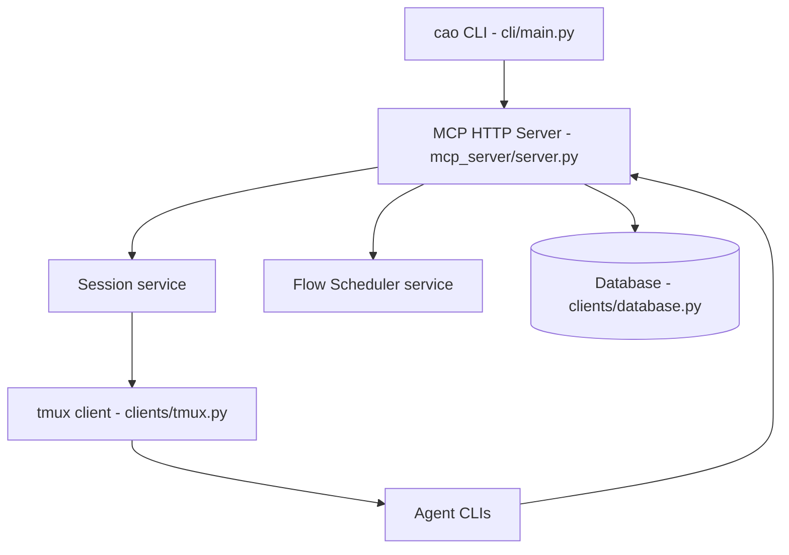

# awslabs/cli-agent-orchestrator

> Orchestrateur qui coordonne plusieurs CLI d'agents de code, un superviseur déléguant à des spécialistes via tmux.

## Le problème
Plusieurs agents de code en CLI ne se parlent pas : coordonner des tâches en parallèle ou en séquence se fait à la main.

## Ce que ça fait vraiment
Lance un serveur local `cao-server` (port 9889) qui démarre chaque CLI de fournisseur (Kiro CLI, Claude Code, Codex, Hermes, Kimi, Qwen, Copilot, OpenCode, Cursor, Grok Build…) dans une session tmux isolée. Les agents échangent par outils MCP : handoff (synchrone), assign (asynchrone), envoi de message via une boîte de réception. Ajoute des profils d'agents Markdown, des flux planifiés, une interface web et des restrictions d'outils.

## Comment c'est branché


## Essayer
```bash
uv tool install git+https://github.com/awslabs/cli-agent-orchestrator.git@main --upgrade
cao install code_supervisor
cao-server
cd /path/to/your/project && cao launch --agents code_supervisor
cao shutdown --session {session-name}
```

## Coût et pièges
Python 3.11+, tmux 3.3+, uv et au moins un CLI de fournisseur déjà authentifié (ses coûts sont à ta charge). Le fournisseur par défaut est Kiro CLI. Les plugins d'agents sont désactivés par défaut. 192 issues ouvertes.

## Ce que ce n'est pas
Pas un framework d'agents avec son propre modèle : il pilote des CLI existants. Pas un service hébergé.

## Alternatives
Aucune alternative nommée dans le README.

## Pour toi
À surveiller si tu enchaînes plusieurs agents de code : un seul mainteneur de plus ne le menace pas, c'est un projet d'AWS Labs.

