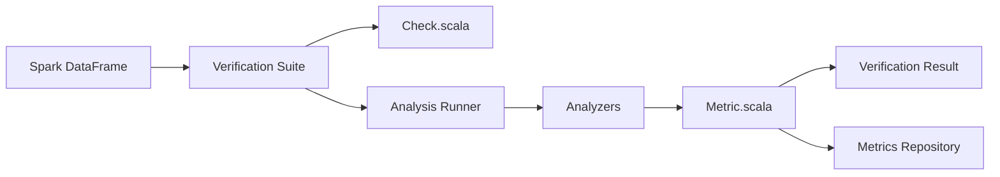

# awslabs/deequ

> Scala library on Spark that writes quality "unit tests" on large DataFrames, for data engineers.

## The problem
Implicit assumptions about data (no NULLs, allowed values) break applications or skew models without anyone noticing.

## What it actually does
You declare `Check`s (size, completeness, uniqueness, allowed values, quantiles) in a `VerificationSuite`. Deequ translates them into Spark jobs, computes metrics, then applies your assertions. It also offers profiling, constraint suggestion, anomaly detection on metric history and DQDL rules.

## How it is wired


## Trying it
```bash
# Maven : dépendance com.amazon.deequ:deequ:2.0.21-spark-3.5 (artefact selon la version de Spark)
libraryDependencies += "com.amazon.deequ" % "deequ" % "2.0.21-spark-3.5"
```

## Cost and gotchas
You need a Spark cluster or session; the artifact must match the Spark version (3.1 to 3.5). Java 11 required since 2.1.0.

## What it is not
Not a Python interface: PyDeequ exists separately. Not a correction tool: it detects, and it is up to you to quarantine. Composite DQDL rules have no row-level result.

## Alternatives
- PyDeequ: same engine, Python interface.

## For you
Adopt if you already validate data under Spark; otherwise the Scala/JVM constraint outweighs the gain.
