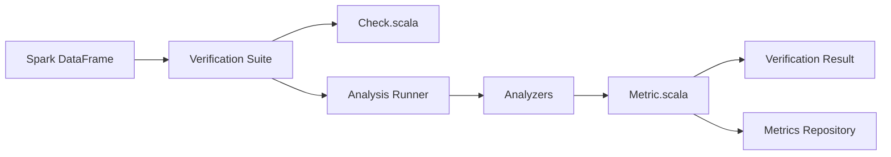

# awslabs/deequ

> Bibliothèque Scala sur Spark qui écrit des « tests unitaires » de qualité sur de gros DataFrames, pour data engineers.

## Le problème
Des hypothèses implicites sur les données (pas de NULL, valeurs permises) cassent les applications ou fausses les modèles sans que personne ne le voie.

## Ce que ça fait vraiment
On déclare des `Check` (taille, complétude, unicité, valeurs permises, quantiles) dans une `VerificationSuite`. Deequ les traduit en jobs Spark, calcule des métriques, puis applique vos assertions. Il propose aussi profilage, suggestion de contraintes, détection d'anomalies sur l'historique de métriques et règles DQDL.

## Comment c'est branché


## Essayer
```bash
# Maven : dépendance com.amazon.deequ:deequ:2.0.21-spark-3.5 (artefact selon la version de Spark)
libraryDependencies += "com.amazon.deequ" % "deequ" % "2.0.21-spark-3.5"
```

## Coût et pièges
Il faut un cluster ou une session Spark ; l'artefact doit correspondre à la version de Spark (3.1 à 3.5). Java 11 requis depuis la 2.1.0.

## Ce que ce n'est pas
Pas une interface Python : PyDeequ existe à part. Pas un outil de correction : il détecte, c'est à vous de mettre en quarantaine. Les règles composites DQDL n'ont pas de résultat au niveau ligne.

## Alternatives
- PyDeequ : même moteur, interface Python.

## Pour toi
À adopter si tu valides déjà des données sous Spark ; sinon la contrainte Scala/JVM pèse plus que le gain.

