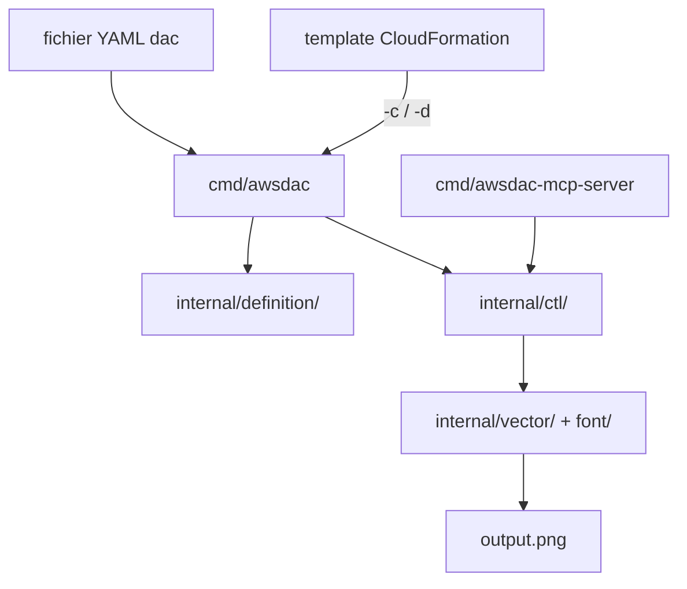

# awslabs/diagram-as-code

> CLI that draws AWS architecture diagrams from versionable YAML, with no browser or GUI.

## The problem
Architecture diagrams live in binary files that can be neither reviewed in a diff nor regenerated in CI.
They drift from the real infrastructure as soon as the first change is not manually carried over.

## What it actually does
Reads a YAML file describing resources and links, produces a PNG that follows AWS diagram conventions.
Automatically adjusts the position and size of groups; handles link placement, their offset and resources on borders.
Converts a CloudFormation template into a diagram (`-c`) or into a dac YAML file (`-d`), both marked beta.
Also usable as a Go library, and accepts definition files to draw non-AWS things.

## How it is wired


## Trying it
```bash
go install github.com/awslabs/diagram-as-code/cmd/awsdac@latest
awsdac examples/alb-ec2.yaml
awsdac privatelink.yaml -o custom-output.png
```

## Cost and gotchas
No key, no account, no third-party service: the tool is local and has no dependency on a headless browser.
Go 1.21 minimum for installation via `go install`, or Homebrew on macOS.

## What it is not
Not a graphical editor: there is no interactive manipulation, only YAML then a render.
Conversion from CloudFormation is explicitly beta, so not the path to favor for a complex existing setup.
Not a generator from deployed infrastructure: it starts from code, not from the account's state.

## Alternatives
No alternative named in the README.

## For you
Useful if your AWS architecture docs must live in Git and be regenerated in CI; irrelevant if you do not draw AWS.
