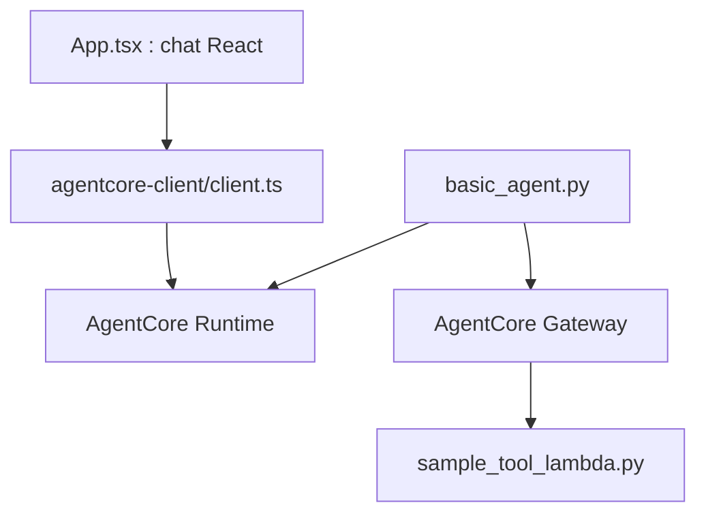

# awslabs/fullstack-solution-template-for-agentcore

> AWS template to deploy a secured React app in front of a Bedrock AgentCore agent.

## The problem
Wiring an agent to AgentCore with authentication, a tool gateway and a web interface takes weeks of infrastructure work.

## What it actually does
A repo to fork: React/Vite frontend (streaming chat), Cognito authentication, containerized Python agent (Strands or LangGraph) on AgentCore Runtime, tools via AgentCore Gateway (Lambda, Cedar policies) and Code Interpreter. Deployment is done with CDK, or with Terraform as an alternative. Best practices are written as documentation to guide a coding assistant.

## How it is wired


## Trying it
```bash
cd infra-cdk
npm install
cdk bootstrap
cdk deploy
cd ..
python scripts/deploy-frontend.py
```

## Cost and gotchas
You need an AWS account: Cognito, Amplify, Lambda, API Gateway and AgentCore are billed. Choose CDK or Terraform and delete the other folder.

## What it is not
AWS states it is a proof of value, not a production-ready solution. It is tied to AgentCore, even though it stays neutral on the agent SDK.

## Alternatives
No alternative named in the README.

## For you
Watch: a good starting point if your target is AWS AgentCore, but locked to AWS and presented as a proof of value.
