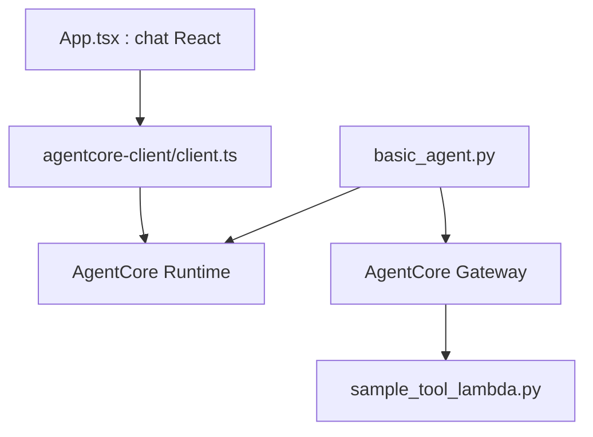

# awslabs/fullstack-solution-template-for-agentcore

> Gabarit AWS pour déployer une appli React sécurisée devant un agent Bedrock AgentCore.

## Le problème
Brancher un agent sur AgentCore avec authentification, passerelle d'outils et interface web demande des semaines d'infrastructure.

## Ce que ça fait vraiment
Un dépôt à forker : frontend React/Vite (chat en streaming), authentification Cognito, agent Python conteneurisé (Strands ou LangGraph) sur AgentCore Runtime, outils via AgentCore Gateway (Lambda, politiques Cedar) et Code Interpreter. Le déploiement se fait en CDK, ou en Terraform comme alternative. Les bonnes pratiques sont écrites en documentation pour guider un assistant de code.

## Comment c'est branché


## Essayer
```bash
cd infra-cdk
npm install
cdk bootstrap
cdk deploy
cd ..
python scripts/deploy-frontend.py
```

## Coût et pièges
Il faut un compte AWS : Cognito, Amplify, Lambda, API Gateway et AgentCore sont facturés. Choisir CDK ou Terraform et supprimer l'autre dossier.

## Ce que ce n'est pas
AWS précise que c'est une preuve de valeur, pas une solution prête pour la production. Il est lié à AgentCore, même s'il reste neutre sur le SDK d'agent.

## Alternatives
Aucune alternative nommée dans le README.

## Pour toi
Surveiller : bon point de départ si ta cible est AWS AgentCore, mais verrouillé sur AWS et présenté comme preuve de valeur.

