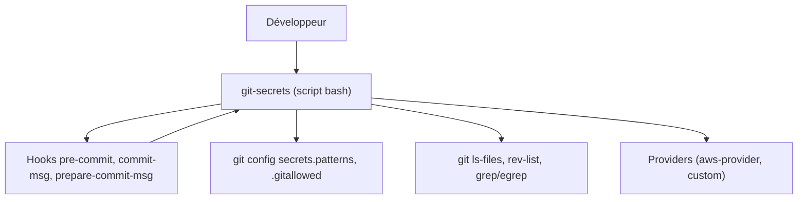

# awslabs/git-secrets

> Shell git hook that blocks commits containing passwords or keys, for any developer.

## The problem
A secret committed by mistake (AWS key, password) stays in the history and ends up exposed.

## What it actually does
Installs three hooks (pre-commit, commit-msg, prepare-commit-msg) that scan files and messages with egrep regexes. Handles prohibited patterns and allowed patterns (false positives), plus "providers" that supply patterns. `--register-aws` adds the AWS patterns (access keys, Bedrock, credentials from the ~/.aws/credentials file). Can also scan the whole history.

## How it is wired
Diagram based on the supplied diagram, reduced to the essentials.



## Trying it
```bash
make install
cd /path/to/my/repo
git secrets --install
git secrets --register-aws
git secrets --scan-history
```

## Cost and gotchas
Free, nothing to create. The README insists: the hooks must be installed in each repository (or via a global template). `--no-verify` bypasses everything. The patterns are not guaranteed to catch everything.

## What it is not
It is not an exhaustive secret scanner nor a key rotation tool: it blocks at the source, with regexes. No entropy-based detection documented.

## Alternatives
No alternative named in the README.

## For you
Adopt: a 5-minute hook that keeps API keys (OpenAI, AWS) out of a repository of notebooks or MLOps pipelines. Last push in September 2025, keep an eye on it.
