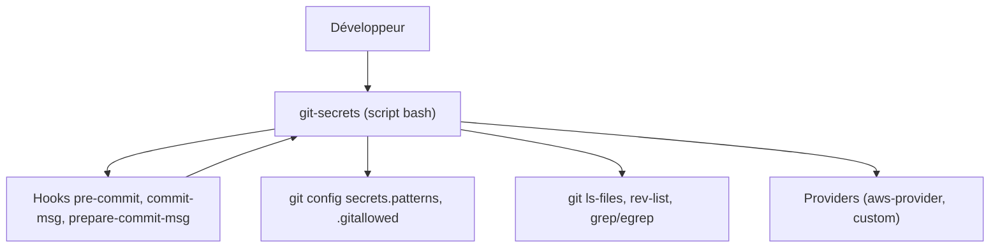

# awslabs/git-secrets

> Hook git en shell qui bloque les commits contenant des mots de passe ou clés, pour tout développeur.

## Le problème
Un secret commité par erreur (clé AWS, mot de passe) reste dans l'historique et finit exposé.

## Ce que ça fait vraiment
Installe trois hooks (pre-commit, commit-msg, prepare-commit-msg) qui scannent fichiers et messages avec des regex egrep. Gère motifs interdits et motifs autorisés (faux positifs), plus des « providers » qui fournissent des motifs. `--register-aws` ajoute les motifs AWS (clés d'accès, Bedrock, identifiants du fichier ~/.aws/credentials). Peut aussi scanner tout l'historique.

## Comment c'est branché
Schéma d'après le diagramme fourni, réduit à l'essentiel.



## Essayer
```bash
make install
cd /path/to/my/repo
git secrets --install
git secrets --register-aws
git secrets --scan-history
```

## Coût et pièges
Gratuit, rien à créer. Le README insiste : il faut installer les hooks dans chaque dépôt (ou via un modèle global). `--no-verify` contourne tout. Les motifs ne sont pas garantis de tout attraper.

## Ce que ce n'est pas
Ce n'est pas un scanner de secrets exhaustif ni un outil de rotation de clés : il bloque à la source, avec des regex. Pas de détection par entropie documentée.

## Alternatives
Aucune alternative nommée dans le README.

## Pour toi
À adopter : un hook de 5 minutes qui évite de pousser des clés d'API (OpenAI, AWS) dans un dépôt de notebooks ou de pipelines MLOps. Dernier push de septembre 2025, à garder à l'œil.

