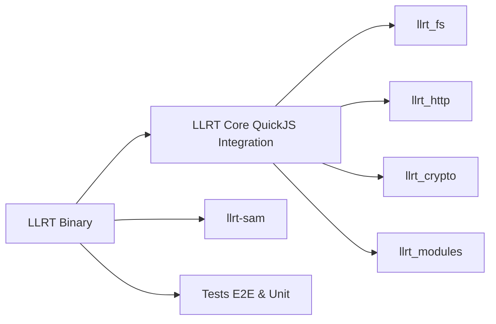

# awslabs/llrt

> AWS lightweight JavaScript runtime, in Rust on QuickJS, for fast startup in Lambda.

## The problem
Node.js, Bun and Deno embed a JIT compiler that is costly in startup time and memory, which penalizes short Lambda functions.

## What it actually does
JIT-less binary that runs ES2023 JavaScript, with a subset of Node APIs, web APIs and integrated, optimized AWS SDK v3 clients (three variants: no-sdk, std-sdk, full-sdk). Deployment as a custom runtime, layer, container image, SAM or CDK. Built-in Jest/Chai-compatible test runner. Claims up to 10x faster startup.

## How it is wired


## Trying it
```bash
llrt test
esbuild index.js --platform=browser --target=es2023 --format=esm --bundle --minify --external:@aws-sdk --external:@smithy
cargo build --release
```

## Cost and gotchas
Free; code must be bundled and TypeScript transpiled before deployment. Slower than JIT runtimes on long computations.

## What it is not
Not a Node.js replacement (the README repeats this): `http`, `worker_threads`, `vm` are missing. Explicitly experimental package, "for evaluation".

## Alternatives
- Node.js, Bun, Deno: general-purpose runtimes to prefer for any heavy processing or any app outside short Lambda functions.

## For you
Ignore for a data/AI profile: very targeted JavaScript optimization for AWS Lambda, unrelated to training or serving models.
