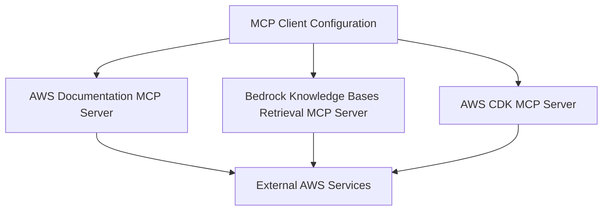

# awslabs/mcp

> Collection of official AWS MCP servers that give AI assistants AWS documentation and services.

## The problem
Coding assistants are unaware of recent AWS APIs and best practices, and cannot act on resources.

## What it actually does
A monorepo of specialized MCP servers: documentation, infrastructure (IaC, CDK, EKS, ECS, Finch), serverless (SAM, Lambda), AI (Bedrock Knowledge Bases, Kendra, Q Index), migration (Transform), and others. AWS-managed remote servers also exist (AWS MCP Server in preview, Knowledge MCP). The servers are launched with `uvx` from an MCP client (Kiro, Cursor, VS Code…). The README announces that the successor is the Agent Toolkit for AWS.

## How it is wired

This diagram comes from the code; the current README does not confirm a coordinating Core server.

## Trying it
Installation goes through button links for Kiro, Cursor and VS Code; the text gives the launch example `uvx awslabs.aws-documentation-mcp-server@latest` (in the configuration settings).

## Cost and gotchas
An AWS account and credentials are required; actions on resources incur AWS costs. Several servers are marked "deprecated" (Cloud Control API, Q Business). Write options (`--allow-write`) should be handled with care.

## What it is not
Not a single server, but a collection; not independent of AWS. The project continues but will partly migrate to the Agent Toolkit for AWS.

## Alternatives
Agent Toolkit for AWS, the successor recommended by the README for production use.

## For you
Worth watching: useful if you work on AWS, but look at the successor toolkit first before committing.
