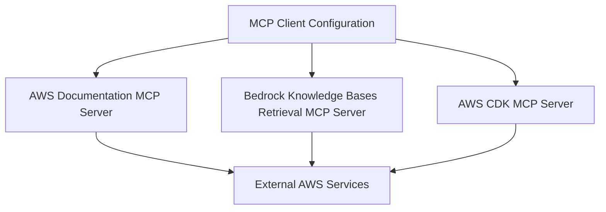

# awslabs/mcp

> Collection de serveurs MCP officiels d'AWS pour donner aux assistants IA la documentation et les services AWS.

## Le problème
Les assistants de code ignorent les API et bonnes pratiques AWS récentes, et ne peuvent pas agir sur les ressources.

## Ce que ça fait vraiment
Un monorepo de serveurs MCP spécialisés : documentation, infrastructure (IaC, CDK, EKS, ECS, Finch), serverless (SAM, Lambda), IA (Bedrock Knowledge Bases, Kendra, Q Index), migration (Transform), et autres. Des serveurs distants gérés par AWS existent aussi (AWS MCP Server en préversion, Knowledge MCP). Les serveurs se lancent avec `uvx` depuis un client MCP (Kiro, Cursor, VS Code…). Le README annonce que le successeur est l'Agent Toolkit for AWS.

## Comment c'est branché

Ce diagramme est issu du code ; le README actuel ne confirme pas de serveur Core coordinateur.

## Essayer
Les installations passent par des liens à bouton pour Kiro, Cursor et VS Code ; le texte donne l'exemple de lancement `uvx awslabs.aws-documentation-mcp-server@latest` (dans les paramètres de configuration).

## Coût et pièges
Compte et identifiants AWS requis ; les actions sur les ressources engendrent des coûts AWS. Plusieurs serveurs sont marqués « deprecated » (Cloud Control API, Q Business). Options d'écriture (`--allow-write`) à manier avec prudence.

## Ce que ce n'est pas
Pas un serveur unique, mais une collection ; pas indépendant d'AWS. Le projet continue mais migrera en partie vers Agent Toolkit for AWS.

## Alternatives
Agent Toolkit for AWS, successeur recommandé par le README pour un usage en production.

## Pour toi
À surveiller : utile si tu travailles sur AWS, mais regarde d'abord le toolkit successeur avant de t'engager.

