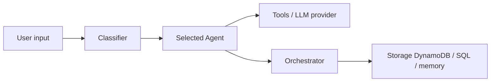

# awslabs/multi-agent-orchestrator

> The Agent Squad framework: routes each request to the right specialized agent, in Python, TypeScript and Swift.

## The problem
With several specialized agents, you have to choose which one answers and keep context between them.

## What it actually does
A classifier reads the agents' descriptions and the history to choose the agent; the orchestrator records the exchange. Ready-made agents (Bedrock, Anthropic, OpenAI, Lex, Lambda), SupervisorAgent (a team working in parallel) and GroundedAgent (one LLM gathers, another writes). On-device Swift runtime for iOS and macOS. The repository was renamed and moved to another organization (2fastlabs/agent-squad).

## How it is wired


## Trying it
```bash
npm install agent-squad
pip install "agent-squad[aws]"
```

## Cost and gotchas
Bedrock, Anthropic or OpenAI models are billed to your account. The classifier adds one LLM call per turn. The address in the README differs from the cataloged repository.

## What it is not
Not an active AWS Labs repository: it has moved. The provided diagram has no readable components.

## Alternatives
- No alternative is named in the README.

## For you
Worth watching: routing between agents and the GroundedAgent are useful, but the repository's move means you must check the active source before adopting it.
