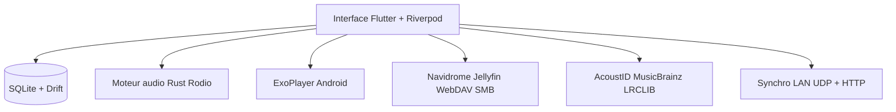

# axel10/vynody

> Cross-platform local music player in Flutter, with word-by-word synchronized lyrics and local network sync.

## The problem
Local music players differ from one platform to another: dated, resource-hungry or inconsistent interfaces.

## What it actually does
Shared Flutter interface, native audio engine per platform (Rust with Rodio and FFmpeg on desktop and iOS, ExoPlayer on Android). It indexes the library in SQLite, completes tags via AcoustID and MusicBrainz, generates lyrics with AI and connects to Navidrome, Jellyfin, WebDAV and SMB. The author says he developed it with an AI-assisted toolchain.

## How it is wired
Simplified diagram based on the fiche, no diagram provided.



## Trying it
```bash
git clone --recurse-submodules https://github.com/axel10/vynody
cd vynody
flutter pub get
flutter run -d <device-id>
```
Binaries are also offered on GitHub Releases and app stores.

## Cost and gotchas
Free. Building requires Flutter 3, the Rust toolchain and the native tooling of the target. AI lyrics use models that must be configured.

## What it is not
Not a data or AI tool: a music player. The GPL-3.0 license requires sharing derivatives.

## Alternatives
No alternative named in the README (Navidrome and Jellyfin are servers it connects to).

## For you
Ignore: consumer application for listening to music, unrelated to your data, AI or MLOps job.
