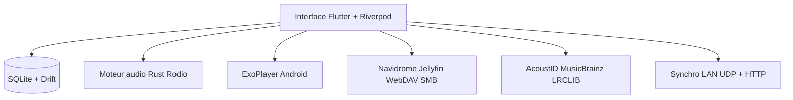

# axel10/vynody

> Lecteur de musique local multiplateforme en Flutter, avec paroles synchronisées mot à mot et synchronisation sur le réseau local.

## Le problème
Les lecteurs de musique locaux diffèrent d'une plateforme à l'autre : interfaces datées, gourmandes ou incohérentes.

## Ce que ça fait vraiment
Interface Flutter commune, moteur audio natif par plateforme (Rust avec Rodio et FFmpeg sur ordinateur et iOS, ExoPlayer sur Android). Il indexe la bibliothèque dans SQLite, complète les tags via AcoustID et MusicBrainz, génère des paroles par IA et se connecte à Navidrome, Jellyfin, WebDAV et SMB. L'auteur dit l'avoir développé avec une chaîne d'assistance par IA.

## Comment c'est branché
Schéma simplifié d'après la fiche, sans diagramme fourni.



## Essayer
```bash
git clone --recurse-submodules https://github.com/axel10/vynody
cd vynody
flutter pub get
flutter run -d <device-id>
```
Des binaires sont aussi proposés sur GitHub Releases et les boutiques d'applications.

## Coût et pièges
Gratuit. La compilation demande Flutter 3, la chaîne Rust et l'outillage natif de la cible. Les paroles par IA utilisent des modèles à configurer.

## Ce que ce n'est pas
Pas un outil de données ni d'IA : un lecteur de musique. La licence GPL-3.0 impose le partage des dérivés.

## Alternatives
Aucune alternative nommée dans le README (Navidrome et Jellyfin sont des serveurs auxquels il se connecte).

## Pour toi
À ignorer : application grand public pour écouter de la musique, sans rapport avec ton métier data, IA ou MLOps.

