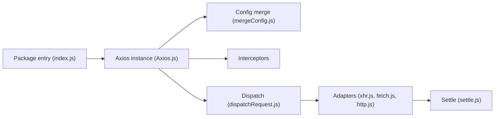

# axios/axios

> A promise-based HTTP client for the browser and Node.js, for JavaScript developers.

## The problem
`XMLHttpRequest` and the native HTTP APIs are verbose; you want promises, interceptors and identical behavior on the browser and server sides.

## What it actually does
You call `axios.get/post/…` or `axios(config)`. The config is merged (defaults, instance, request), the request interceptors run, then an adapter (XHR, Fetch or Node's HTTP) sends the request and returns a response in a common format. Extras: cancellation (`AbortController`), JSON serialization, form-data and urlencoded, progress, rate limiting, `AxiosError` errors, TypeScript types.

## How it is wired


## Trying it
```bash
npm install axios
yarn add axios
pnpm add axios
```
Then `const response = await axios.get('/user?ID=12345');` (README example).

## Cost and gotchas
Free. Security: `maxContentLength` and `maxBodyLength` default to -1 (unlimited); the README recommends setting a cap when facing untrusted servers, and a `timeout` in production. The README opens with a long list of sponsors, including betting sites.

## What it is not
Not a request framework with built-in caching or retries. The `axios.all`, `axios.spread` and `CancelToken` helpers are deprecated.

## Alternatives
No alternative named in the README.

## For you
Ignore: a JavaScript HTTP client, outside the daily work of a data/AI profile that tends to call APIs from Python.
