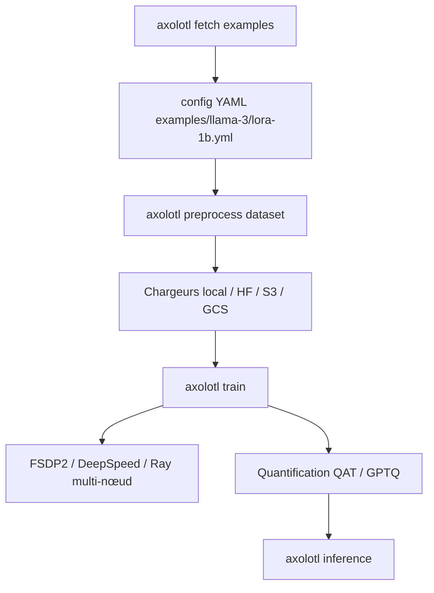

# axolotl-ai-cloud/axolotl

> LLM post-training suite driven by a single YAML, for fine-tuning practitioners.

## The problem
Each post-training method (LoRA, DPO, GRPO, QAT) comes with its own script, dataset formats and optimization options.
Gluing all that together by hand for multi-GPU or multi-node takes more time than the training itself.

## What it actually does
One YAML file covers dataset preprocessing, training, evaluation, quantization and inference.
Methods: full fine-tuning, LoRA/QLoRA, GPTQ, QAT (int8/int4/FP8/NVFP4/MXFP4), DPO/IPO/KTO/ORPO, GRPO/GDPO, reward and process reward models.
Text models, VLMs (Qwen2-VL, Pixtral, LLaVA, InternVL, Gemma 3n…) and audio (Voxtral).
Optimizations: multipacking, Flash Attention 2/3/4, Liger Kernel, ScatterMoE, sequence parallelism, FSDP1/2, DeepSpeed, Torchrun, Ray.

## How it is wired


## Trying it
```bash
curl -LsSf https://astral.sh/uv/install.sh | sh
uv venv --python 3.12
source .venv/bin/activate
uv pip install torch==2.12.1 torchvision
uv pip install --no-build-isolation axolotl[deepspeed]
axolotl fetch examples
axolotl train examples/llama-3/lora-1b.yml
docker run --gpus '"all"' --ipc=host --rm -it axolotlai/axolotl:main-latest
```

## Cost and gotchas
The software is free; the GPU is not — Ampere or newer for bf16 and Flash Attention, or an AMD GPU.
Telemetry enabled by default (system, model type, error rate): `AXOLOTL_DO_NOT_TRACK=1` to turn it off.

## What it is not
Not a training service: you provide the machine, or rent from RunPod, Modal, Vast.ai, Novita, JarvisLabs, Latitude.sh.
Not primarily a from-scratch pre-training tool, even though `agent-docs pretraining` covers continued pre-training.
Not production inference: the `inference` part is for checking a model, not serving traffic.

## Alternatives
- No alternative named in the README; the only repositories cited are models and GPU providers.

## For you
It is the reference to know if you fine-tune LLMs or VLMs: a versionable YAML rather than a throwaway script.
