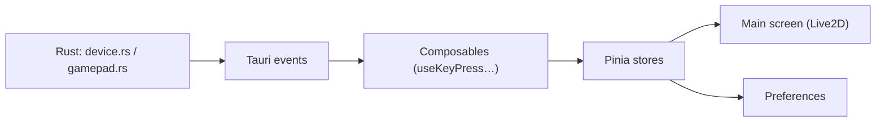

# ayangweb/BongoCat

> Desktop Live2D cat that reacts to keystrokes, mouse and gamepad.

## The problem
No professional problem: it is a decorative desktop companion.

## What it actually does
An animated Live2D cat on screen follows the mouse and reacts to keys, mouse buttons and gamepad. Customizable models, draggable window. Works offline without data collection, according to the README. Tauri application: Vue 3 frontend with Pinia, Rust backend for input hooks, window and admin plugins.

## How it is wired

## Trying it
No command documented in the README (download of the macOS/Windows releases).

## Cost and gotchas
Free. Global keyboard capture: system permissions are requested on macOS and Windows.

## What it is not
Not a productivity tool; Linux is not announced in the README (configs exist).

## Alternatives
- Bongo-Cat-Mver: the project it is inspired by.

## For you
Fun but of no value for your work; a program that listens to all keystrokes deserves caution anyway.
