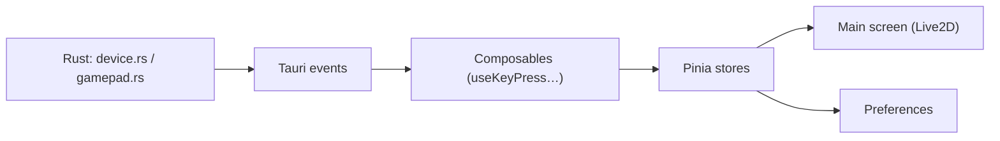

# ayangweb/BongoCat

> Chat Live2D de bureau qui réagit aux frappes clavier, à la souris et à la manette.

## Le problème
Aucun problème professionnel : c'est un compagnon de bureau décoratif.

## Ce que ça fait vraiment
Un chat Live2D animé sur l'écran suit la souris, réagit aux touches, boutons de souris et de manette. Modèles personnalisables, fenêtre déplaçable. Fonctionne hors ligne sans collecte de données, d'après le README. Application Tauri : frontend Vue 3 avec Pinia, backend Rust pour les hooks d'entrée, plugins fenêtre et admin.

## Comment c'est branché

## Essayer
Aucune commande documentée dans le README (téléchargement des versions macOS/Windows).

## Coût et pièges
Gratuit. Capture globale du clavier : permissions système demandées sur macOS et Windows.

## Ce que ce n'est pas
Pas un outil de productivité ; Linux n'est pas annoncé dans le README (des configs existent).

## Alternatives
- Bongo-Cat-Mver : le projet dont il s'inspire.

## Pour toi
Amusant mais sans valeur pour ton métier ; un programme qui écoute toutes les frappes mérite de toute façon de la prudence.

