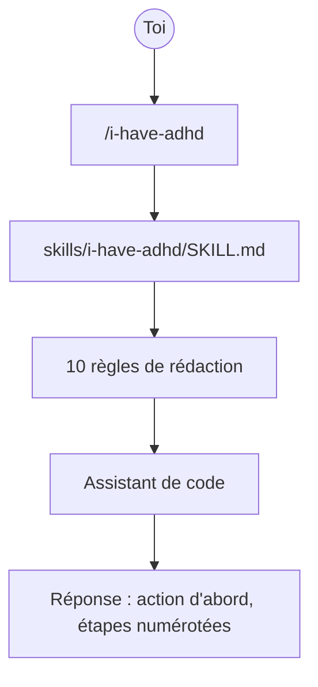

# ayghri/i-have-adhd

> This skill requires a coding assistant to respond directly with an action, without any introduction or extraneous comments.

## The problem
The responses from the assistant obscure the only useful information – the command to type – with context, alternatives, and polite phrases.

## What it actually does
Install a skill/plugin containing ten writing rules, as detailed in `SKILL.md`.
The rules: start with the next action, number the steps, end with a concrete step,
eliminate irrelevant tangents, remind the reader of the current state at each turn, and provide durations in minutes.
Also: make progress visible, announce errors directly, limit lists to five items, and ban introductory statements, summaries, and closing formulas. The README shows a before-and-after example.

## How it is wired


## Trying it
```bash
claude plugin uninstall i-have-adhd            # drop the upstream copy first:
claude plugin marketplace remove i-have-adhd   # fork and upstream share both names
claude plugin marketplace add <your-username>/i-have-adhd
claude plugin install i-have-adhd@i-have-adhd
```

## Cost and gotchas
Free to use, with no additional installation required beyond the plugin. These commands are those of the *fork*: for the upstream version, the README includes an installation prompt in natural language within the assistant.

## What it is not
This is not a medical tool: the title refers to ADHD, but the instructions state that no diagnosis is required. It is not a model or an agent, but simply a set of style guidelines. Adapted from *The Adult ADHD Tool Kit* for use with a large language model (LLM), not for organizing your day.

## Alternatives
No alternative is specified in the README file.

## For you
If your interactions with the assistant are costing you more time than they are saving you, consider testing it out for a week.
