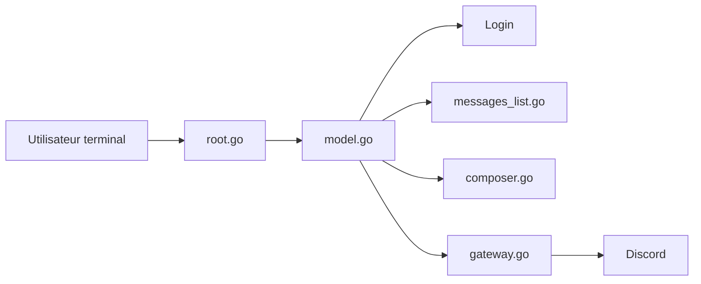

# ayn2op/discordo

> Terminal Discord client written in Go, for chatting from the command line.

## The problem
Using Discord requires the heavy graphical client; some people want to stay in a terminal.

## What it actually does
Text interface: navigation by servers and channels, message list, composer with attachments and mentions, Markdown rendering. Login by password, QR code or token (`DISCORDO_TOKEN` variable). The token is stored in the keyring, the configuration in a `config.toml`.

## How it is wired


## Trying it
```bash
git clone https://github.com/ayn2op/discordo
cd discordo
go build .
./discordo
```

## Cost and gotchas
Free, a Discord account is required. The README warns: automated user accounts ("self-bots") violate Discord's terms of service, with a risk of losing the account.

## What it is not
Not a bot nor an official Discord API: it connects with your personal account.

## Alternatives
No alternative named in the README.

## For you
Ignore: a messaging client unrelated to your work, and the risk of an account ban is not worth it.
