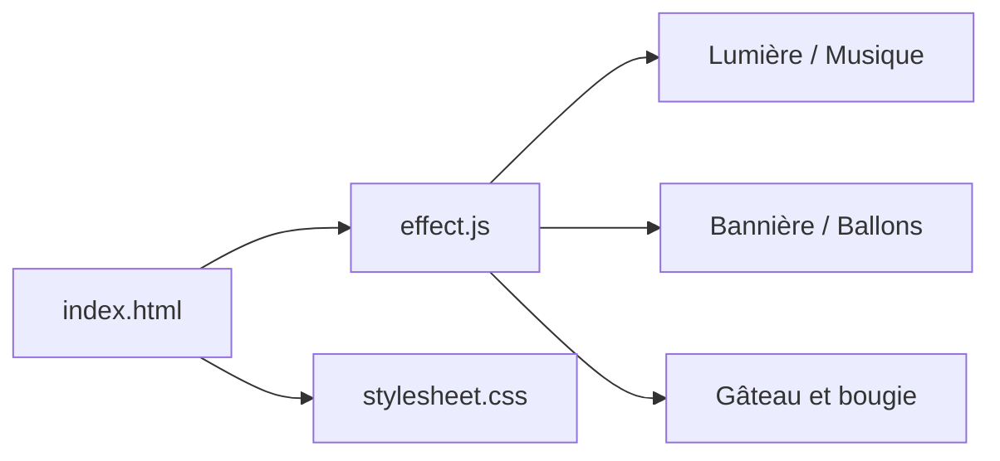

# ayusharma/birthday

> Birthday animation in CSS3, HTML5 and jQuery, to open in a browser.

## The problem
Giving an animated birthday card without an application.

## What it actually does
A static page: a visitor triggers steps (light, music, banner, balloons, cake and candle, message), driven by `effect.js`. Stylesheets and an audio file `hbd.mp3` complete the page.

## How it is wired


## Trying it
```bash
cd Birthday
python -m SimpleHTTPServer --port 8081
npm install
npm run server-node
```

## Cost and gotchas
Free. No license; last push in August 2024. The Python command cited is the Python 2 one.

## What it is not
Not a reusable tool or library: a demo page.

## Alternatives
No alternative named in the README.

## For you
Ignore: decorative animation, unlicensed and unrelated to data/AI/MLOps.
