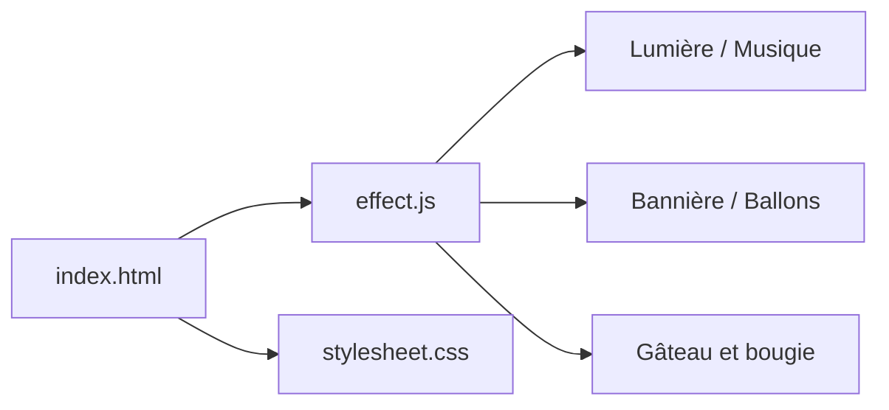

# ayusharma/birthday

> Animation d'anniversaire en CSS3, HTML5 et jQuery, à ouvrir dans un navigateur.

## Le problème
Offrir une carte d'anniversaire animée sans application.

## Ce que ça fait vraiment
Une page statique : un visiteur déclenche des étapes (lumière, musique, bannière, ballons, gâteau et bougie, message), pilotées par `effect.js`. Des feuilles de style, un fichier audio `hbd.mp3` complètent la page.

## Comment c'est branché


## Essayer
```bash
cd Birthday
python -m SimpleHTTPServer --port 8081
npm install
npm run server-node
```

## Coût et pièges
Gratuit. Aucune licence ; dernier push en août 2024. La commande Python citée est celle de Python 2.

## Ce que ce n'est pas
Pas un outil ni une bibliothèque réutilisable : une page de démonstration.

## Alternatives
Aucune alternative nommée dans le README.

## Pour toi
À ignorer : animation décorative, sans licence et sans rapport avec data/IA/MLOps.

