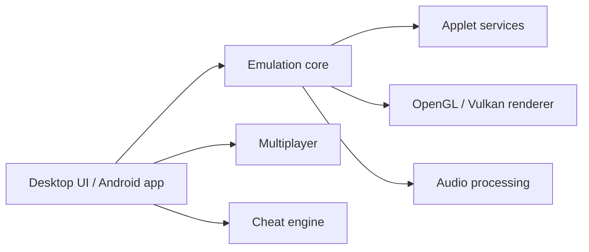

# azahar-emu/azahar

> Free Nintendo 3DS emulator for PC and mobile, continuation of Citra.

## The problem
Running your 3DS game library with enhancements (resolution, controllers, save states) on modern hardware.

## What it actually does
High-level emulator with desktop, Android, command-line and libretro frontends, OpenGL and Vulkan rendering, audio, network play, cheat codes, custom textures and debugging tools for homebrew developers. Windows, macOS, Linux (Flatpak, AppImage) and Android.

## How it is wired

## Trying it
No command documented. Installation by download from the Releases page, Flatpak (Flathub), Google Play or Obtainium.

## Cost and gotchas
Free. Minimum configuration: OpenGL 4.3 or Vulkan 1.1 GPU, 2 GB of RAM (4 GB recommended). GPL-3.0 license. Not affiliated with Nintendo.

## What it is not
Not a turnkey piracy tool: you need your own games, and the README does not cover how to obtain them.

## Alternatives
- Citra: the project Azahar takes over from.

## For you
Ignore: game emulator, outside your data/AI scope.
