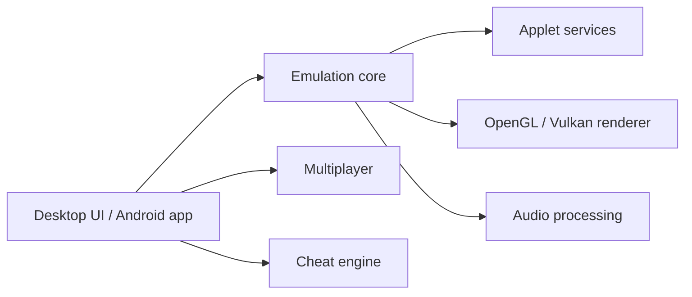

# azahar-emu/azahar

> Émulateur Nintendo 3DS libre pour PC et mobile, continuation de Citra.

## Le problème
Faire tourner sa ludothèque 3DS avec des améliorations (résolution, manettes, sauvegardes d'état) sur du matériel moderne.

## Ce que ça fait vraiment
Émulateur de haut niveau avec interfaces de bureau, Android, ligne de commande et libretro, rendus OpenGL et Vulkan, audio, jeu en réseau, codes de triche, textures personnalisées et outils de débogage pour développeurs de homebrew. Windows, macOS, Linux (Flatpak, AppImage) et Android.

## Comment c'est branché

## Essayer
Aucune commande documentée. Installation par téléchargement depuis la page Releases, Flatpak (Flathub), Google Play ou Obtainium.

## Coût et pièges
Gratuit. Configuration minimale : GPU OpenGL 4.3 ou Vulkan 1.1, 2 Go de RAM (4 Go conseillés). Licence GPL-3.0. Non affilié à Nintendo.

## Ce que ce n'est pas
Pas un outil de piratage clé en main : il faut tes propres jeux, et le README ne traite pas de leur obtention.

## Alternatives
- Citra : projet dont Azahar prend la suite.

## Pour toi
À ignorer : émulateur de jeux, hors de ton périmètre data/IA.

