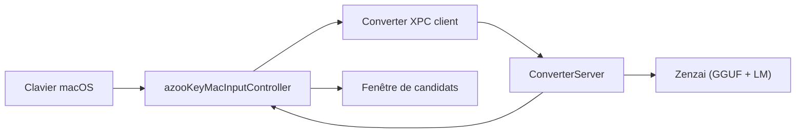

# azooKey/azooKey-Desktop

> Japanese input method for macOS with neural kana-kanji conversion (Zenzai).

## The problem
Classic Japanese IMEs convert imperfectly; here a neural model improves accuracy.

## What it actually does
Installed as a macOS input source. The input controller relays keystrokes over XPC to an isolated ConverterServer process that keeps the conversion state, then displays the candidates and inserts the text. Features: history, user dictionary, live conversion, AZIK, LLM-based "magic conversion" (Apple Foundation Models or OpenAI). The README is in Japanese.

## How it is wired


## Trying it
```bash
brew install azooKey
brew upgrade azooKey
```
Then log out and back in and add the input source.

## Cost and gotchas
The README announces an alpha version "without any warranty". Building requires Xcode 26.1+, Git LFS and submodules. LLM conversion may call OpenAI.

## What it is not
Not a general AI project: a Japanese IME. It is useless outside Japanese typing.

## Alternatives
The README cites the ports fcitx5-hazkey (Linux), azooKey-Windows and azoo-key-skkserv.

## For you
Ignore, unless you write a lot in Japanese: nothing to take from it for data/MLOps work, and the alpha comes with no warranty.
