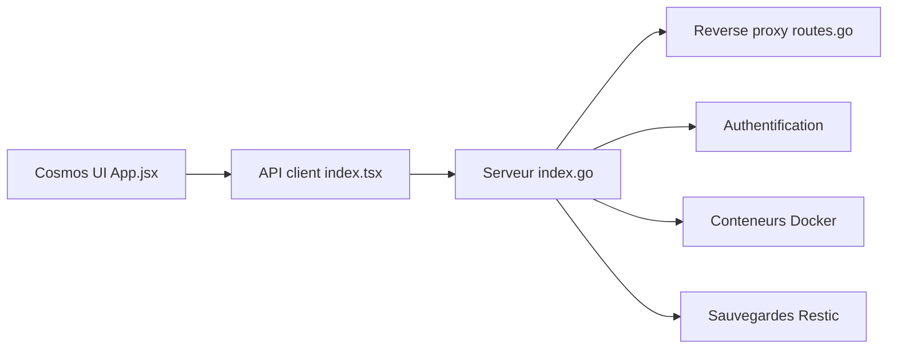

# azukaar/Cosmos-Server

> Self-hosted home server: reverse proxy, authentication, containers, VPN and backups in a single web interface.

## The problem
Self-hosted applications (Plex, HomeAssistant, photos) each reimplement their own authentication and remain exposed without shared protection.

## What it actually does
Cosmos sits as a gateway in front of your containers: reverse proxy with automatic HTTPS, multi-factor authentication and OpenID, SmartShield (rate limiting, bans, anti-bot). It adds an app store, container and disk management, a VPN (Constellation), backups via Restic, monitoring and CRON tasks. A JS SDK, a Go SDK and a Terraform provider exist.

## How it is wired


## Trying it
```bash
sudo docker run -d --network host --privileged --name cosmos-server -h cosmos-server --restart=always -v /var/run/docker.sock:/var/run/docker.sock -v /var/run/dbus/system_bus_socket:/var/run/dbus/system_bus_socket -v /:/mnt/host -v /var/lib/cosmos:/config azukaar/cosmos-server:latest
```
Then open `http://ip-du-serveur` and follow the wizard.

## Cost and gotchas
Free. The command mounts the Docker socket, and optionally the whole disk, in privileged mode: that is very broad access. Do not go through the Unraid, CasaOS or Portainer templates. License not identified by GitHub: read it before any commercial use.

## What it is not
Not a file manager or a virtual machine manager (the README says so). Not an add-on to place behind another reverse proxy. The README's comparisons are the author's own.

## Alternatives
- Unraid: handles VMs, which Cosmos does not.
- YunoHost, CasaOS, Cloudron: alternatives cited in the README, more app-store oriented.

## For you
Worth watching: useful for a homelab hosting MLOps tools, but the privileged Docker socket access and the unclear license need checking.
